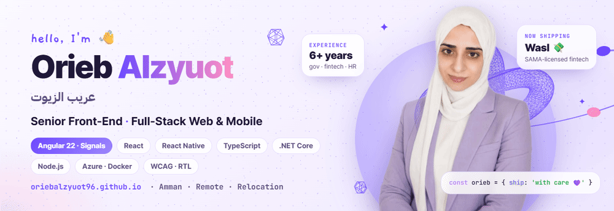
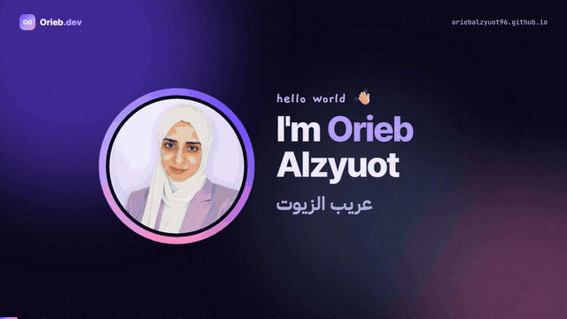

  <picture>
    <source media="(prefers-color-scheme: dark)" srcset="./orieb-banner-dark.gif" />
    
  </picture>

<h1 align="center">Hi, I'm Orieb <bdi>عريب الزيوت</bdi> 💜</h1>

  <b>Senior Front-End · Full-Stack Web & Mobile Engineer</b> · Amman, Jordan 🇯🇴 
  I build the interfaces people rely on, and the services behind them. 
  Remote · Relocation · Full-time · Contract · Freelance

  
  
  
  
  

---

## 💜 About Orieb

I've shipped production UI for **6+ years**, on **government, fintech, HR and enterprise products** that people use every day, for teams in Saudi Arabia, the UAE and Jordan. I design the system before the screens: feature boundaries, Signals-based state, typed API contracts and shared design tokens, so a large team can move fast without breaking each other's work.

- **I own it end to end.** I take projects from Figma / Adobe XD to production and stay accountable after launch: code review, CI/CD, and the 2 a.m. bug.
- **I modernise without downtime.** I've worked in every Angular era, **AngularJS → 8 → 14 → 16 → 21/22**, and I migrate legacy apps to **Signals** step by step while features keep shipping.
- **Angular is home,** alongside **React, React Native, Next.js, Astro and Svelte**.
- **I go full stack when it matters:** **.NET Core and Node.js** services, **PostgreSQL / MongoDB**, and **Azure** deployments in **Docker**.
- **Human-first, always.** Accessibility (WCAG), Arabic/RTL that feels native, honest error states, and AI that helps people rather than replacing them.
- **Why I do this 🌱.** I love seeing a website succeed because it genuinely helps people: a citizen filing a complaint in minutes, an employee paid on time, a family comparing financing offers on their phone.

   
  ▶ My 40-second intro with original music and captions (English / العربية), on <a href="https://oriebalzyuot96.github.io/#intro">my portfolio</a>

**💼 Work with me:** full-time, contract or freelance, remote or relocation. I do Angular migrations, front-end architecture, React Native apps, Astro sites, and WCAG / Arabic RTL audits. 
[Freelance / remote, worldwide](https://oriebalzyuot96.github.io/hire/freelance/) · [Saudi Arabia](https://oriebalzyuot96.github.io/hire/saudi-arabia/) · [UAE](https://oriebalzyuot96.github.io/hire/uae/) · [Jordan](https://oriebalzyuot96.github.io/hire/jordan/) · [العربية](https://oriebalzyuot96.github.io/ar/)

## 🧩 Platforms I've delivered

| Platform | What it is | My part | Access |
| --- | --- | --- | --- |
| 💸 **Wasl · Digital Financing Platform** <bdi>منصة وصل للخدمات التمويلية</bdi> | Digital financing brokerage: a 50/50 JV of Saudi Azm and the National Housing Company that connects customers with licensed lenders. SAMA licence granted Aug 2026 ([Argaam](https://www.argaam.com/en/article/articledetail/id/1832972)) | Front-end architecture for the request, offer and tracking flows; accessible fintech UI | Launching |
| 🏛️ **Saudi Bar Association: Complaints & Reports** <bdi>خدمة الشكاوى والبلاغات — الهيئة السعودية للمحامين</bdi> | Unified service for complaints against lawyers and reports against people impersonating the profession | Front-end architecture, QC review workflow, applicant dashboard, RTL / WCAG | [qccx.sba.gov.sa](https://qccx.sba.gov.sa/) · Nafath / staff sign-in |
| 🏗️ **Saudi Engineering Arbitration Center** <bdi>مركز التحكيم الهندسي السعودي</bdi> | E-arbitration for engineering disputes under the Saudi Council of Engineers | Role-based portals for arbitrators, establishments, individuals and experts; case filing and hearings | [Client environment](https://web01.techprocess.net:28059) |
| 📄 **Contracts: Digital Contracts & e-Signature** <bdi>عقود — منصة العقود الرقمية</bdi> | Create, manage and e-sign contracts for individuals and companies | Contract builder, sign-in flows, bilingual documents | [contracts.com.sa](https://contracts.com.sa) · public sign-up |
| ⚖️ **Meerath · Ministry of Justice** <bdi>ميراث — وزارة العدل</bdi> | Digital inheritance platform: estates are inventoried and divided among heirs online | Front-end delivery with Saudi Azm | Government · restricted |
| 🧭 **Mirafh Portal** <bdi>بوابة مرافه</bdi> | Enterprise digital platform | Component library, responsive UI from Figma / XD | Not public yet |
| 🧩 **Low-code automation** · Tahaluf Al Emarat | Low-code / no-code business automation for UAE government and enterprise | Angular 16 + PrimeNG designer modules, load-time and memory fixes | Internal |
| 📊 **HR solution: Payroll & Performance** · Shepherd | Cloud human-capital-management suite | Features, bug fixes and performance work across **AngularJS, Angular 8 and Angular 14** | Customer sign-in |
| 🎓 **E-learning system** · Shepherd | Employee training alongside the HR suite | Course, enrolment and learner-progress screens | Customer sign-in |
| 🗺️ **Indoor Navigation CMS** · PenguinIN | Venue CMS behind PenNav / PenTrack indoor positioning | React + OpenLayers CMS, Node + PostgreSQL API | [penguinin.com](https://penguinin.com) |
| ✨ **Sample 03 · 3D landing page** | Cinematic bilingual landing page: Three.js hero, dark/light scroll transition, 3D fact cards | Design and build (Astro + Three.js), EN / AR RTL | [Live demo](https://oriebalzyuot96.github.io/sample-3/) · [Code](https://github.com/oriebalzyuot96/sample-3) |
| 💎 **Bareeq Al-Aeeq** <bdi>بريق العقيق</bdi> | Luxury interior-design brand: marketing site with consultation booking, client portal and mobile app on shared design tokens | Everything: Angular 21, React Native (Expo) | [Screenshots](https://oriebalzyuot96.github.io/#p-bareeq) |
| 🧭 **Al Taqadum Al Mustamer** <bdi>التقدّم المستمر</bdi> | Business-automation website with a 7-step partnership assessment | Angular 22 build from Figma, EN / AR RTL | [Screenshots](https://oriebalzyuot96.github.io/#p-taqadum) |
| 📱 **Asset Conversion · AED ⇄ USDT** | Fintech mobile app: live quotes, exact decimal maths, themes, accessibility | Everything: React Native + TypeScript, 60 tests | [Code & demo](https://github.com/oriebalzyuot96/asset-conversion) |

## 💼 Experience

**Saudi Azm (Azm Digital)** · Senior Front-End & Full-Stack Developer · *Nov 2023 – Present · Remote* 
A Riyadh digital-government company listed on Nomu, building platforms for the public and private sectors.
- I lead the end-to-end front-end architecture of **government and fintech** platforms: **Wasl**, the **Saudi Bar Association**, **Meerath** (Ministry of Justice), **Engineering Arbitration**, **Contracts** and **Mirafh**.
- I drive the migration of legacy apps to **Angular v21/v22 with Signals**, for faster rendering and long-term maintainability.
- I introduced **Docker** across front-end projects, giving us reproducible environments and consistent, secure CI/CD.
- I build and scale **.NET Core and Node.js** microservices on **Microsoft Azure**, and design REST APIs and **PostgreSQL** integrations for heavy data flows.
- I ship cross-platform features in **React Native** that share business logic between web and mobile.
- I run technical reviews and sprint planning in Jira, and use **Claude / Cursor** for AI-assisted delivery.

**Tahaluf Al Emarat Technical Solutions** · Front-End Web Developer · *Jun – Nov 2023 · Amman*
- Built key modules of a **low-code / no-code automation platform** in **Angular 16 + PrimeNG**, cutting initial load time and memory use.
- Reported PrimeNG defects upstream with reproducers (see below).

**Shepherd Technologies** · Front-End Web Developer · *Nov 2021 – Jun 2023 · Amman*
- Worked across three generations of the **HR solution (AngularJS 1.x, Angular 8 and Angular 14)**, shipping features, bug fixes and performance improvements.
- Delivered **Payroll and Performance** SPAs on REST APIs, and contributed to the **e-learning system** (courses, enrolment, learner progress).
- Refactored legacy front-end code for accessibility, maintainability and speed.

**PenguinIN** · Full-Stack Web Developer · *Nov 2020 – Nov 2021 · Amman*
- Owned an **indoor-navigation CMS** end to end: a map-heavy React + OpenLayers front end on a Node.js / PostgreSQL API.

## 🧰 Skills

**Frameworks & Web**

  
  
  
  
  
  
  
  
  
  
  

**Languages**

  
  
  
  
  
  
  

**Cloud, Data, Quality & Design**

  
  
  
  
  
  
  
  
  
  

## 🐛 Bugs I've reported upstream

When a library breaks in production, I report it upstream with a reproducer instead of quietly working around it, so the next developer doesn't hit the same wall.

| Library | Report | What happened | Status |
| --- | --- | --- | --- |
| 📄 **Mozilla pdf.js** (`pdfjs-dist` 5.4) | [#20306](https://github.com/mozilla/pdf.js/issues/20306) | After an upgrade, PDFs stopped rendering on iPhone 15 Pro (Safari/Chrome) but still worked on iPhone 11. I isolated the device-specific mobile regression. | ✅ Closed / resolved |
| 🎨 **PrimeNG** (Angular 16) | [#13468](https://github.com/primefaces/primeng/issues/13468) | After the new `processedItems` internals, `ContextMenu` items could no longer be swapped at right-click time; the old `model` override silently stopped working. | ✅ Closed / resolved |
| 🎨 **PrimeNG** | [#13479](https://github.com/primefaces/primeng/issues/13479) | `Dialog` / `DynamicDialog` drag broke when the cursor crossed into the body, and the drag handle disappeared mid-drag. | ✅ Closed / resolved |
| 🎨 **PrimeNG** | [#13506](https://github.com/primefaces/primeng/issues/13506) | `Dropdown` virtual scroll only worked client-side, so I proposed server-side lazy loading (page index and size on scroll-to-end). | ✅ Closed |
| 🅰️ **yangular** | [#61](https://github.com/yantrab/yangular/issues/61) | Requested an upgrade to current Angular versions. | 🟣 Open |

## 🤖 What's next for Orieb: AI

I already ship with Claude, Claude Code and Cursor every day. Next, I'm building **LLM-powered features inside real products**: agents that take on repetitive work, and AI-first UX such as copilots, smart forms and chat. What I'm learning: Anthropic and OpenAI APIs, RAG, prompt engineering and Python.

  
  
  
  
  

## 📊 Languages I write

  

## 🎓 Education & certifications

- **B.Sc. Communication & Software Engineering**, Al-Balqa Applied University · 2014 – 2018 · GPA **3.58 / 4.00** · **ranked 2nd in my class** 🥈
- **Full Stack Web Development Intensive**, Hack Reactor curriculum · Mar – Aug 2020 · 12-week immersive
- **Verified LinkedIn skills:** Angular · React.js · Node.js · JavaScript · TypeScript · Git · Agile

## ⏱️ The Orieb way

> **Forget "just 5 minutes."** Open the editor and write code, and the next hour takes care of itself.

That idea is behind my **[5min](https://oriebalzyuot96.github.io/samples/5min/)** habit: ship something small every day. My fish-and-whale mindset 🐋: start tiny, grow big, and **smile** while you do it.

---

  <b>Open to senior and lead front-end roles</b>: remote or relocation, full-time or contract. 
  <a href="https://oriebalzyuot96.github.io">Portfolio</a> · <a href="./Orieb-Alzyuot-CV.pdf">CV</a> · <a href="mailto:alzuotorieb9999@gmail.com">alzuotorieb9999@gmail.com</a>  
  <b>Built with care by Orieb 💜</b>

